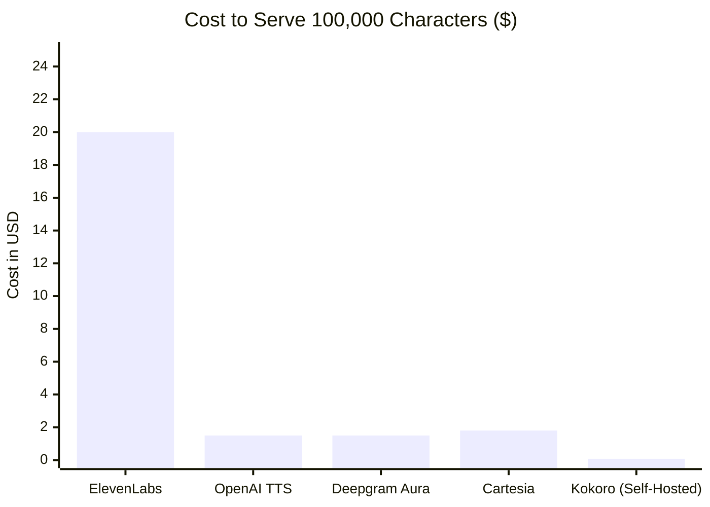
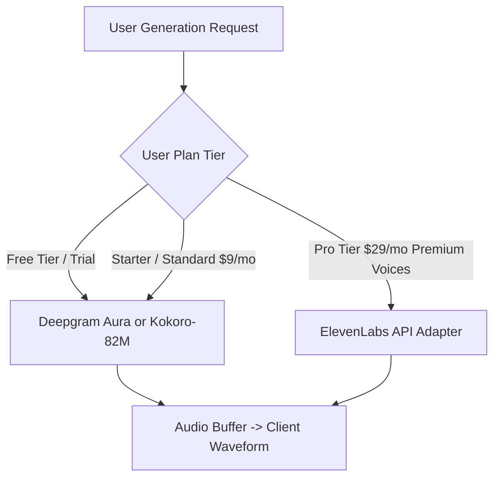

# AI Voice Generation Provider Research & Comparative Evaluation

**Document Version:** 1.0  
**Status:** Comprehensive Analysis  
**Author:** AI Research & Infrastructure Team  
**Last Updated:** October 2026  

---

## 1. Executive Summary

Selecting the appropriate text-to-speech (TTS) engine dictates product defensibility, audio fidelity, infrastructure unit economics, and operational risk. This report evaluates commercial cloud TTS APIs against modern open-source models across **audio quality (MOS)**, **pricing per million characters**, **latency**, **commercial licensing terms**, and **self-hosting compute overhead**.

> [!WARNING]
> **Commercial Licensing Trap**:
> Several prominent "free" or open-source models (notably **Coqui XTTS v2** under the CPML license) strictly **prohibit commercial usage** without custom paid licensing agreements. Furthermore, free tiers of cloud APIs (such as ElevenLabs Free) forbid commercial monetization and require attribution.

---

## 2. Comprehensive Provider Comparison Matrix

| Provider / Model | Delivery Type | Price / 1M Chars | Latency (TTFA) | Audio Quality (MOS 1–5) | Commercial Licensing | Self-Hosting Requirements |
| :--- | :--- | :--- | :--- | :--- | :--- | :--- |
| **ElevenLabs (Turbo v2.5 / v3)** | Cloud API | **\$150 – \$300** (\$0.15–\$0.30/1k) | ~250ms – 400ms | **4.8 / 5.0** (Industry Gold Standard) | Commercial rights granted on **paid plans only** (Starter+). Free tier requires attribution and is strictly non-commercial. | Managed cloud; zero infrastructure required. |
| **Deepgram Aura** | Cloud API | **\$15.00** (\$0.015/1k) | **<150ms** (Fastest) | **4.4 / 5.0** (High clarity, lower dramatic range) | **Full commercial rights** on all pay-as-you-go tiers. | Managed cloud; WebSocket & REST endpoints. |
| **OpenAI (tts-1 / tts-1-hd)** | Cloud API | **\$15.00** (tts-1) / **\$30.00** (hd) | ~400ms – 700ms | **4.5 / 5.0** (Polished, limited voice diversity: 6 voices) | **Full commercial ownership** of output audio. | Managed cloud; standard REST endpoint. |
| **Cartesia (Sonic)** | Cloud API | **\$18.00** (\$0.018/1k) | **~100ms – 135ms** | **4.6 / 5.0** (Very expressive, state space architecture) | **Full commercial rights** on paid API tiers. | Managed cloud; WebSocket streaming. |
| **Amazon Polly (Neural)** | Cloud API | **\$16.00** | ~350ms – 600ms | **3.8 / 5.0** (Robotic / corporate tone) | Full commercial rights on AWS account. | Managed cloud (AWS). |
| **Kokoro-82M** | **Open Source (Self-Hosted)** | **Compute only** (~$0.50–\$2.00/1M chars on serverless GPU) | ~180ms – 300ms on GPU; ~500ms on CPU | **4.5 / 5.0** (Remarkable fidelity for 82M parameter size) | **Apache 2.0**: **Permissive commercial use permitted** without royalties. | Lightweight: 82M params; runs on CPU or low-cost GPU (NVIDIA T4 / RTX 3060, <2GB VRAM). |
| **Coqui XTTS v2** | Open Source (Self-Hosted) | Compute only | ~800ms – 1500ms | **4.4 / 5.0** (Great voice cloning capabilities) | **CPML (Coqui Public Model License)**: **STRICTLY NON-COMMERCIAL**. Commercial use requires commercial license. | Heavy: 2.4GB model; requires minimum 8GB VRAM GPU (A10G / RTX 4090). |
| **Piper TTS** | Open Source (Self-Hosted) | Compute only | **<50ms** | **3.6 / 5.0** (Fast, but noticeable robotic inflection) | **MIT License**: Fully commercial. | Ultra-lightweight: Runs smoothly on Raspberry Pi 4 / cheap VPS CPU. |

---

## 3. Deep Dive: Commercial Cloud TTS APIs

### 3.1 ElevenLabs API
- **Strengths**: Unmatched emotional expressiveness, vocal stability, breathing/laughing realism, and expansive voice library.
- **Weaknesses**: High cost (\$0.15–\$0.30 per 1,000 characters), which compresses SaaS gross margins if charging low retail subscription prices.
- **Best Role in MVP**: Premium tier voice engine for users who demand top-tier cinematic or audiobook quality.

### 3.2 Deepgram Aura
- **Strengths**: Extremely low latency (<150ms TTFA), highly reliable uptime, and disruption-level low pricing (\$15 per 1 million characters / ~\$0.015 per 1,000 characters).
- **Weaknesses**: Smaller voice selection (~12 voices), less dynamic emotional range than ElevenLabs.
- **Best Role in MVP**: The **ideal default engine** for cost-effective standard generations, conversational voice agents, and high-margin SaaS scaling.

### 3.3 Cartesia Sonic
- **Strengths**: Groundbreaking State-Space Model (SSM) architecture delivering 100ms latency with high naturalness and voice cloning support.
- **Weaknesses**: Newer ecosystem, fewer community integrations than OpenAI or ElevenLabs.
- **Best Role in MVP**: Excellent alternative for ultra-fast conversational and social media use cases.

### 3.4 OpenAI TTS (`tts-1` / `tts-1-hd`)
- **Strengths**: Ubiquitous, simple developer integration, clean neutral sound, fair pricing (\$15/1M chars for `tts-1`).
- **Weaknesses**: Strictly limited to 6 stock voices (Alloy, Echo, Fable, Onyx, Nova, Shimmer), zero voice cloning, minimal prosodic tuning sliders.
- **Best Role in MVP**: Solid secondary backup provider for general narration.

---

## 4. Deep Dive: Open-Source & Self-Hosted Models

### 4.1 Kokoro-82M (The Open-Source Winner)
- **Architecture**: A compact 82-million parameter diffusion-based neural TTS model.
- **License**: **Apache 2.0** (Commercially safe, zero license fees).
- **Fidelity**: Achieves a Mean Opinion Score (MOS) comparable to models 10x its size.
- **Self-Hosting Feasibility**:
  - Because it has only 82M parameters, it can be deployed on serverless GPU containers (Modal, RunPod, or AWS ECS with NVIDIA T4) with cold starts under 1.5 seconds.
  - Generates 1 minute of audio in under 1 second of compute time.
  - Estimated inference cost: **\$0.0005 per 1,000 characters** (over 90% cheaper than cloud APIs).

### 4.2 Coqui XTTS v2 (Legal Caveat Warning)
- While technically impressive for instant zero-shot voice cloning, **XTTS v2 is released under the CPML (Coqui Public Model License)**.
- Section 2 of CPML explicitly states that using model weights or outputs for revenue-generating commercial services is prohibited without a commercial license. Since Coqui as a corporate entity has dissolved, acquiring formal commercial rights is legally ambiguous.
- **Recommendation**: **Do not use XTTS v2** for commercial SaaS production.

---

## 5. Economic & Margin Impact Modeling

Assuming a user generates **100,000 characters** (~100 minutes of spoken audio):

### Strategic Implications for SaaS Pricing:
1. **If using ElevenLabs exclusively**:
   - Serving 100k characters costs the SaaS **\$15.00 to \$25.00** in API fees.
   - Charging a user \$20/month yields near-zero or negative gross margins.
2. **If using Deepgram Aura or Cartesia**:
   - Serving 100k characters costs the SaaS **\$1.50 to \$1.80**.
   - Charging a user \$15/month yields an exceptional **88% – 90% gross margin**.
3. **If using Kokoro-82M on serverless GPU**:
   - Serving 100k characters costs the SaaS **< \$0.10**.
   - Enables unlimited free trials or aggressive pricing with **98%+ gross margins**.

---

## 6. Recommended Multi-Provider Strategy for MVP

### The Three-Phase Provider Roadmap:
1. **MVP Launch (Current)**:
   - **Primary Engine**: **Deepgram Aura** for default high-speed voices (\$15/1M chars).
   - **Premium Engine (Optional Toggle)**: **ElevenLabs API** for users requesting premier ultra-expressive character voices.
   - **Local Sandbox Engine**: Embedded PCM synthesizer for instant local development without requiring external keys.
2. **Phase 2 (Scale & Margin Optimization)**:
   - Deploy **Kokoro-82M** on a serverless GPU cluster (Modal / RunPod) for Free and Starter tier speech generation, cutting API costs by 95%.
3. **Phase 3 (Enterprise Real-Time)**:
   - Introduce **Cartesia Sonic** via WebSocket for sub-150ms bidirectional conversational voice agents.
