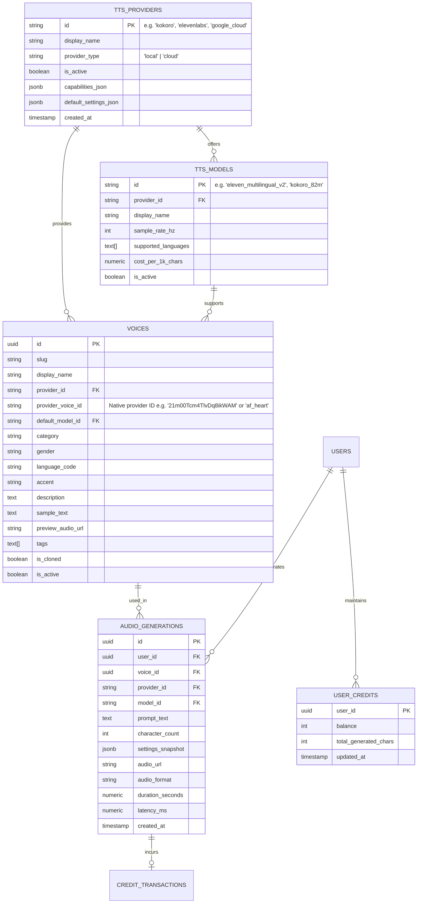

# Relational Database Schema v2: Multi-Provider TTS Architecture

**Engine:** PostgreSQL 16+ / Supabase  
**Status:** Approved Multi-Provider Relational Model  

---

## 1. Schema Overview

This schema decouples internal application voice references from vendor-specific voice identifiers, allowing arbitrary new providers and models to be introduced dynamically without schema revisions.



---

## 2. SQL Migration Script (PostgreSQL 16)

```sql
-- 1. Providers Table
CREATE TABLE IF NOT EXISTS tts_providers (
    id VARCHAR(64) PRIMARY KEY, -- 'kokoro', 'elevenlabs', 'google_cloud', 'gemini', 'edge_tts'
    display_name VARCHAR(128) NOT NULL,
    provider_type VARCHAR(32) NOT NULL DEFAULT 'cloud' CHECK (provider_type IN ('local', 'cloud', 'hybrid')),
    website_url TEXT,
    is_active BOOLEAN NOT NULL DEFAULT true,
    capabilities JSONB NOT NULL DEFAULT '{}'::jsonb,
    created_at TIMESTAMPTZ NOT NULL DEFAULT NOW()
);

-- 2. Models Table
CREATE TABLE IF NOT EXISTS tts_models (
    id VARCHAR(128) PRIMARY KEY,
    provider_id VARCHAR(64) NOT NULL REFERENCES tts_providers(id) ON DELETE CASCADE,
    display_name VARCHAR(128) NOT NULL,
    sample_rate_hz INTEGER NOT NULL DEFAULT 24000,
    supported_languages TEXT[] NOT NULL DEFAULT ARRAY['en'],
    cost_per_1k_chars NUMERIC(10, 4) NOT NULL DEFAULT 0.0000,
    is_active BOOLEAN NOT NULL DEFAULT true,
    created_at TIMESTAMPTZ NOT NULL DEFAULT NOW()
);

-- 3. Dynamic Voice Catalogue
CREATE TABLE IF NOT EXISTS voice_catalogue (
    id UUID PRIMARY KEY DEFAULT gen_random_uuid(),
    slug VARCHAR(128) NOT NULL UNIQUE,
    display_name VARCHAR(128) NOT NULL,
    provider_id VARCHAR(64) NOT NULL REFERENCES tts_providers(id) ON DELETE RESTRICT,
    provider_voice_id VARCHAR(128) NOT NULL, -- Native vendor ID
    default_model_id VARCHAR(128) REFERENCES tts_models(id),
    category VARCHAR(64) NOT NULL CHECK (category IN ('conversational', 'narration', 'characters', 'social_media', 'cloned')),
    gender VARCHAR(32) NOT NULL CHECK (gender IN ('female', 'male', 'non-binary')),
    language_code VARCHAR(16) NOT NULL DEFAULT 'en-US',
    accent VARCHAR(64) NOT NULL DEFAULT 'Neutral',
    description TEXT,
    sample_text TEXT NOT NULL,
    preview_audio_url TEXT,
    tags TEXT[] NOT NULL DEFAULT '{}',
    is_cloned BOOLEAN NOT NULL DEFAULT false,
    is_active BOOLEAN NOT NULL DEFAULT true,
    created_at TIMESTAMPTZ NOT NULL DEFAULT NOW(),
    CONSTRAINT uq_provider_voice UNIQUE (provider_id, provider_voice_id)
);

-- 4. Audio Generations Table
CREATE TABLE IF NOT EXISTS audio_generations (
    id UUID PRIMARY KEY DEFAULT gen_random_uuid(),
    user_id UUID, -- NULL for anonymous community usage
    voice_id UUID REFERENCES voice_catalogue(id) ON DELETE SET NULL,
    provider_id VARCHAR(64) NOT NULL REFERENCES tts_providers(id),
    model_id VARCHAR(128) NOT NULL,
    prompt_text TEXT NOT NULL,
    character_count INTEGER NOT NULL,
    settings_snapshot JSONB NOT NULL DEFAULT '{}'::jsonb,
    audio_url TEXT NOT NULL,
    audio_format VARCHAR(16) NOT NULL DEFAULT 'wav',
    duration_seconds NUMERIC(8, 2) NOT NULL DEFAULT 0.0,
    inference_latency_ms INTEGER,
    created_at TIMESTAMPTZ NOT NULL DEFAULT NOW()
);

-- 5. User Credits Table
CREATE TABLE IF NOT EXISTS user_credits (
    user_id UUID PRIMARY KEY,
    balance INTEGER NOT NULL DEFAULT 100000,
    total_generated_chars INTEGER NOT NULL DEFAULT 0,
    tier VARCHAR(32) NOT NULL DEFAULT 'free',
    updated_at TIMESTAMPTZ NOT NULL DEFAULT NOW()
);

-- Indexes for high-throughput queries
CREATE INDEX IF NOT EXISTS idx_voice_catalogue_provider ON voice_catalogue(provider_id);
CREATE INDEX IF NOT EXISTS idx_voice_catalogue_language ON voice_catalogue(language_code);
CREATE INDEX IF NOT EXISTS idx_voice_catalogue_category ON voice_catalogue(category);
CREATE INDEX IF NOT EXISTS idx_audio_generations_user ON audio_generations(user_id, created_at DESC);
```
