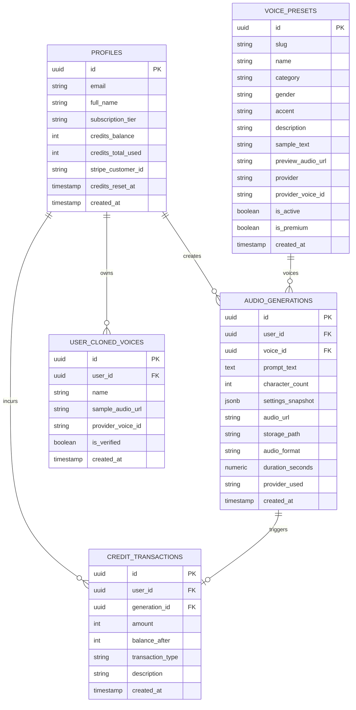

# Database Architecture & Relational Schema: Original AI Voice SaaS

**Document Version:** 1.0  
**Status:** Approved Schema Specification  
**Database Engine:** PostgreSQL 16+ (Supabase Architecture)  
**Security Model:** Mandatory Row Level Security (RLS) & Multi-Tenant Isolation  

---

## 1. Entity-Relationship Diagram (ERD)



---

## 2. Table Specifications & Data Dictionaries

### 2.1 `profiles` (User Account & Subscription State)
Extends the core authentication identity table (`auth.users`) to maintain subscriber metadata and live credit balances.

| Column Name | Data Type | Constraints | Description |
| :--- | :--- | :--- | :--- |
| `id` | `UUID` | `PRIMARY KEY, REFERENCES auth.users(id) ON DELETE CASCADE` | Matches the authenticated user's unique identity. |
| `email` | `TEXT` | `NOT NULL, UNIQUE` | User primary email address. |
| `full_name` | `TEXT` | `NULLABLE` | Display name. |
| `subscription_tier` | `TEXT` | `NOT NULL DEFAULT 'free'` | Enum: `'free'`, `'starter'`, `'creator'`, `'pro'`, `'enterprise'`. |
| `credits_balance` | `INTEGER` | `NOT NULL DEFAULT 10000, CHECK (credits_balance >= 0)` | Current available generation credits (characters). |
| `credits_total_used` | `INTEGER` | `NOT NULL DEFAULT 0` | Cumulative lifetime characters generated. |
| `stripe_customer_id` | `TEXT` | `NULLABLE, UNIQUE` | External Stripe billing customer identifier. |
| `credits_reset_at` | `TIMESTAMPTZ` | `NOT NULL DEFAULT (NOW() + INTERVAL '1 month')` | Scheduled timestamp for monthly credit quota replenishment. |
| `created_at` | `TIMESTAMPTZ` | `NOT NULL DEFAULT NOW()` | Record creation timestamp. |
| `updated_at` | `TIMESTAMPTZ` | `NOT NULL DEFAULT NOW()` | Last update timestamp. |

---

### 2.2 `voice_presets` (Curated Voice Library)
Stores all system-provided and curated voice actors available for synthesis.

| Column Name | Data Type | Constraints | Description |
| :--- | :--- | :--- | :--- |
| `id` | `UUID` | `PRIMARY KEY DEFAULT gen_random_uuid()` | Unique internal identifier. |
| `slug` | `TEXT` | `NOT NULL, UNIQUE` | Human-readable identifier (e.g. `elise-conversational`). |
| `name` | `TEXT` | `NOT NULL` | Display name (e.g. `Elise Vance`). |
| `category` | `TEXT` | `NOT NULL` | Enum: `'conversational'`, `'narration'`, `'characters'`, `'social_media'`. |
| `gender` | `TEXT` | `NOT NULL` | Enum: `'female'`, `'male'`, `'non-binary'`. |
| `accent` | `TEXT` | `NOT NULL` | E.g. `American (Standard)`, `British (RP)`. |
| `description` | `TEXT` | `NULLABLE` | Use-case guidance for users. |
| `sample_text` | `TEXT` | `NOT NULL` | Default script used for audio previews. |
| `preview_audio_url` | `TEXT` | `NOT NULL` | Publicly cached audio sample URL. |
| `provider` | `TEXT` | `NOT NULL` | Backing engine: `'deepgram'`, `'elevenlabs'`, `'cartesia'`, `'kokoro'`. |
| `provider_voice_id` | `TEXT` | `NOT NULL` | Provider's raw external voice identifier. |
| `is_active` | `BOOLEAN` | `NOT NULL DEFAULT TRUE` | Soft-delete / availability toggle. |
| `is_premium` | `BOOLEAN` | `NOT NULL DEFAULT FALSE` | True if restricted to Pro tier and above. |
| `created_at` | `TIMESTAMPTZ` | `NOT NULL DEFAULT NOW()` | Creation timestamp. |

---

### 2.3 `audio_generations` (Speech Generation Logs & History)
Stores every successfully rendered audio output, prompt text, and applied parameters.

| Column Name | Data Type | Constraints | Description |
| :--- | :--- | :--- | :--- |
| `id` | `UUID` | `PRIMARY KEY DEFAULT gen_random_uuid()` | Unique generation identifier. |
| `user_id` | `UUID` | `NOT NULL, REFERENCES profiles(id) ON DELETE CASCADE` | Creator user identifier. |
| `voice_id` | `UUID` | `NOT NULL, REFERENCES voice_presets(id) ON DELETE RESTRICT` | Voice model utilized. |
| `prompt_text` | `TEXT` | `NOT NULL` | Script text synthesized. |
| `character_count` | `INTEGER` | `NOT NULL` | Character length (matches credits consumed). |
| `settings_snapshot` | `JSONB` | `NOT NULL` | JSON snapshot of tuning: `{"stability": 0.5, "speed": 1.0, "similarity": 0.75}`. |
| `audio_url` | `TEXT` | `NOT NULL` | CDN-accessible URL for in-browser playback. |
| `storage_path` | `TEXT` | `NOT NULL` | Exact bucket key path on object storage (R2/S3). |
| `audio_format` | `TEXT` | `NOT NULL DEFAULT 'audio/wav'` | MIME type (`audio/wav`, `audio/mpeg`). |
| `duration_seconds` | `NUMERIC(6,2)` | `NOT NULL` | Length of synthesized audio file in seconds. |
| `provider_used` | `TEXT` | `NOT NULL` | Provider invoked (`Deepgram Aura`, `ElevenLabs API`, etc.). |
| `created_at` | `TIMESTAMPTZ` | `NOT NULL DEFAULT NOW()` | Creation timestamp. |

---

### 2.4 `credit_transactions` (Double-Entry Accounting Ledger)
An immutable write-ahead ledger recording every debit, credit replenishment, and tier upgrade.

| Column Name | Data Type | Constraints | Description |
| :--- | :--- | :--- | :--- |
| `id` | `UUID` | `PRIMARY KEY DEFAULT gen_random_uuid()` | Unique transaction ID. |
| `user_id` | `UUID` | `NOT NULL, REFERENCES profiles(id) ON DELETE CASCADE` | Affected user account. |
| `generation_id` | `UUID` | `NULLABLE, REFERENCES audio_generations(id) ON DELETE SET NULL` | Linked generation if debit. |
| `amount` | `INTEGER` | `NOT NULL` | Negative for debits (`-45`), positive for credits (`+30000`). |
| `balance_after` | `INTEGER` | `NOT NULL` | Exact user balance snapshot immediately after execution. |
| `transaction_type` | `TEXT` | `NOT NULL` | Enum: `'tts_generation'`, `'monthly_renewal'`, `'tier_upgrade'`, `'top_up'`. |
| `description` | `TEXT` | `NULLABLE` | Human-readable audit note. |
| `created_at` | `TIMESTAMPTZ` | `NOT NULL DEFAULT NOW()` | Transaction timestamp. |

---

## 3. SQL Data Definition Language (DDL) & Indexes

```sql
-- Enable necessary extensions
CREATE EXTENSION IF NOT EXISTS "uuid-ossp";

-- 1. Profiles Table
CREATE TABLE profiles (
    id UUID PRIMARY KEY REFERENCES auth.users(id) ON DELETE CASCADE,
    email TEXT NOT NULL UNIQUE,
    full_name TEXT,
    subscription_tier TEXT NOT NULL DEFAULT 'free' CHECK (subscription_tier IN ('free', 'starter', 'creator', 'pro', 'enterprise')),
    credits_balance INTEGER NOT NULL DEFAULT 10000 CHECK (credits_balance >= 0),
    credits_total_used INTEGER NOT NULL DEFAULT 0,
    stripe_customer_id TEXT UNIQUE,
    credits_reset_at TIMESTAMPTZ NOT NULL DEFAULT (NOW() + INTERVAL '1 month'),
    created_at TIMESTAMPTZ NOT NULL DEFAULT NOW(),
    updated_at TIMESTAMPTZ NOT NULL DEFAULT NOW()
);

-- 2. Voice Presets Table
CREATE TABLE voice_presets (
    id UUID PRIMARY KEY DEFAULT gen_random_uuid(),
    slug TEXT NOT NULL UNIQUE,
    name TEXT NOT NULL,
    category TEXT NOT NULL CHECK (category IN ('conversational', 'narration', 'characters', 'social_media')),
    gender TEXT NOT NULL CHECK (gender IN ('female', 'male', 'non-binary')),
    accent TEXT NOT NULL,
    description TEXT,
    sample_text TEXT NOT NULL,
    preview_audio_url TEXT NOT NULL,
    provider TEXT NOT NULL,
    provider_voice_id TEXT NOT NULL,
    is_active BOOLEAN NOT NULL DEFAULT TRUE,
    is_premium BOOLEAN NOT NULL DEFAULT FALSE,
    created_at TIMESTAMPTZ NOT NULL DEFAULT NOW()
);

-- 3. Audio Generations Table
CREATE TABLE audio_generations (
    id UUID PRIMARY KEY DEFAULT gen_random_uuid(),
    user_id UUID NOT NULL REFERENCES profiles(id) ON DELETE CASCADE,
    voice_id UUID NOT NULL REFERENCES voice_presets(id) ON DELETE RESTRICT,
    prompt_text TEXT NOT NULL,
    character_count INTEGER NOT NULL,
    settings_snapshot JSONB NOT NULL,
    audio_url TEXT NOT NULL,
    storage_path TEXT NOT NULL,
    audio_format TEXT NOT NULL DEFAULT 'audio/wav',
    duration_seconds NUMERIC(6,2) NOT NULL,
    provider_used TEXT NOT NULL,
    created_at TIMESTAMPTZ NOT NULL DEFAULT NOW()
);

-- 4. Credit Transactions Ledger
CREATE TABLE credit_transactions (
    id UUID PRIMARY KEY DEFAULT gen_random_uuid(),
    user_id UUID NOT NULL REFERENCES profiles(id) ON DELETE CASCADE,
    generation_id UUID REFERENCES audio_generations(id) ON DELETE SET NULL,
    amount INTEGER NOT NULL,
    balance_after INTEGER NOT NULL,
    transaction_type TEXT NOT NULL CHECK (transaction_type IN ('tts_generation', 'monthly_renewal', 'tier_upgrade', 'top_up')),
    description TEXT,
    created_at TIMESTAMPTZ NOT NULL DEFAULT NOW()
);

-- High-Performance Query Indexes
CREATE INDEX idx_generations_user_created ON audio_generations (user_id, created_at DESC);
CREATE INDEX idx_transactions_user_created ON credit_transactions (user_id, created_at DESC);
CREATE INDEX idx_voices_category_active ON voice_presets (category, is_active);
```

---

## 4. Race-Condition-Free Credit Deduction Stored Procedure

To ensure high-concurrency requests cannot double-spend credits or exploit race conditions:

```sql
CREATE OR REPLACE FUNCTION deduct_user_credits(
    p_user_id UUID,
    p_amount INTEGER,
    p_generation_id UUID,
    p_description TEXT
)
RETURNS INTEGER
LANGUAGE plpgsql
AS $$
DECLARE
    v_current_balance INTEGER;
    v_new_balance INTEGER;
BEGIN
    -- Select with row-level lock (FOR UPDATE)
    SELECT credits_balance INTO v_current_balance
    FROM profiles
    WHERE id = p_user_id
    FOR UPDATE;

    IF v_current_balance IS NULL THEN
        RAISE EXCEPTION 'User profile not found';
    END IF;

    IF v_current_balance < p_amount THEN
        RAISE EXCEPTION 'Insufficient credit balance (Required: %, Available: %)', p_amount, v_current_balance;
    END IF;

    v_new_balance := v_current_balance - p_amount;

    -- Update balance
    UPDATE profiles
    SET credits_balance = v_new_balance,
        credits_total_used = credits_total_used + p_amount,
        updated_at = NOW()
    WHERE id = p_user_id;

    -- Write immutable transaction audit entry
    INSERT INTO credit_transactions (
        user_id,
        generation_id,
        amount,
        balance_after,
        transaction_type,
        description
    ) VALUES (
        p_user_id,
        p_generation_id,
        -p_amount,
        v_new_balance,
        'tts_generation',
        p_description
    );

    RETURN v_new_balance;
END;
$$;
```

---

## 5. Row Level Security (RLS) Policies

```sql
-- Enable RLS across all sensitive tables
ALTER TABLE profiles ENABLE ROW LEVEL SECURITY;
ALTER TABLE audio_generations ENABLE ROW LEVEL SECURITY;
ALTER TABLE credit_transactions ENABLE ROW LEVEL SECURITY;
ALTER TABLE voice_presets ENABLE ROW LEVEL SECURITY;

-- 1. Profiles: Users can only read and update their own profile
CREATE POLICY "Users can read own profile" ON profiles
    FOR SELECT USING (auth.uid() = id);

CREATE POLICY "Users can update own profile name" ON profiles
    FOR UPDATE USING (auth.uid() = id);

-- 2. Audio Generations: Users can only view and delete their own generations
CREATE POLICY "Users can read own audio generations" ON audio_generations
    FOR SELECT USING (auth.uid() = user_id);

CREATE POLICY "Users can insert own audio generations" ON audio_generations
    FOR INSERT WITH CHECK (auth.uid() = user_id);

-- 3. Credit Transactions: Users can view their own ledger history
CREATE POLICY "Users can read own credit transactions" ON credit_transactions
    FOR SELECT USING (auth.uid() = user_id);

-- 4. Voice Presets: Publicly readable by all authenticated and anonymous visitors
CREATE POLICY "Voice presets are publicly readable" ON voice_presets
    FOR SELECT USING (is_active = TRUE);
```
