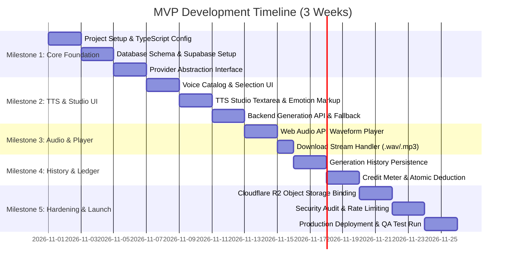

# Development Roadmap & MVP Implementation Milestones

**Document Version:** 1.0  
**Status:** Implementation Blueprint  
**Target Completion:** 3–4 Weeks  
**Guiding Principles:** Small surface area, zero-leakage security, provider abstraction, low-cost infrastructure.

---

## 1. Roadmap Overview & Timeline

---

## 2. Milestone Breakdown & Deliverables

### Milestone 1: Project Scaffolding, Data Layer & Provider Abstraction
**Duration:** Days 1–4  
**Primary Goal:** Establish the project foundation, secure database schema, and decouple the AI voice generation engine.

- **Tasks**:
  1. Initialize Next.js 15 App Router project with TypeScript, Tailwind CSS, and strict linting.
  2. Configure Supabase PostgreSQL schema with `profiles`, `voice_presets`, `audio_generations`, and `credit_transactions` tables.
  3. Deploy Row Level Security (RLS) policies and the atomic stored procedure `deduct_user_credits()`.
  4. Implement `IVoiceProvider` interface with adapter stubs for Deepgram Aura, ElevenLabs, and an in-memory local harmonic synthesizer fallback.
- **Key Deliverables**:
  - Compiling Next.js project with type definitions.
  - Supabase migration script (`schema.sql`).
  - Unit tests verifying the provider abstraction switches between engines based on `.env` configuration.
- **Exit Criteria**: Running `npm run build` succeeds with zero TypeScript errors; provider interface successfully outputs sample audio buffers.

---

### Milestone 2: Curated Voice Library & Text-to-Speech Studio UI
**Duration:** Days 5–8  
**Primary Goal:** Build the primary workstation interface where users compose scripts, pick voices, and tune synthesis parameters.

- **Tasks**:
  1. Populate `voice_presets` table with 8+ curated studio voices (varied accents, genders, and use-case tags).
  2. Build `VoiceSelectorModal` with category filtering (`conversational`, `narration`, `characters`, `social_media`) and audio sample preview buttons.
  3. Build the Studio script editor with live character counter, word count estimator, and emotion tag chips (`[whispers]`, `[softly]`, `[laughs]`).
  4. Implement sliders for **Stability**, **Clarity/Similarity Boost**, **Style Exaggeration**, and **Pacing/Speed Factor**.
  5. Connect frontend to `/api/tts/generate` endpoint.
- **Key Deliverables**:
  - Studio UI page (`/studio`) with reactive state management.
  - Server-side route handler `/api/tts/generate` with parameter validation.
- **Exit Criteria**: User can type text, select a voice, adjust sliders, click "Generate Speech", and receive a valid audio payload.

---

### Milestone 3: Web Audio Waveform Player & Download Pipeline
**Duration:** Days 9–11  
**Primary Goal:** Provide a responsive, delightful audio preview and download experience.

- **Tasks**:
  1. Build `AudioWaveformPlayer` leveraging the browser **Web Audio API** (`AudioContext` + canvas/SVG sound bars).
  2. Implement Play/Pause, click-to-seek progress bar, elapsed time, and total duration display.
  3. Add playback speed cycle button ($0.8\times, 1.0\times, 1.25\times, 1.5\times$).
  4. Implement single-click audio file download (`/api/audio/:id/download`) with appropriate MIME headers (`audio/wav`, `audio/mpeg`).
- **Key Deliverables**:
  - Reusable waveform audio player component.
  - Download route serving sanitized attachment filenames.
- **Exit Criteria**: Audio playback starts with $<100$ms perceived latency; seeking works smoothly; download saves a playable `.wav` or `.mp3` file to the desktop.

---

### Milestone 4: Generation History & Atomic Credit Ledger
**Duration:** Days 12–15  
**Primary Goal:** Enable asset recall and enforce credit monetization limits safely.

- **Tasks**:
  1. Implement `/api/history` endpoint fetching the authenticated user's last 20 generations in reverse-chronological order.
  2. Build the Generation History sidebar panel: display prompt preview, voice name, creation timestamp, and direct replay button.
  3. Add "Reuse Prompt" button that re-populates the editor with past text and settings.
  4. Connect the live credit balance indicator in the sidebar: deducting 1 credit per character synthesized using the atomic PostgreSQL function.
  5. Build the Quota Exceeded modal warning users when their balance is insufficient.
- **Key Deliverables**:
  - History sidebar component with replay and copy actions.
  - Real-time credit deduction and balance synchronization.
- **Exit Criteria**: Generating a 50-character prompt debits exactly 50 credits; zero balance prevents subsequent generation with a user-friendly modal.

---

### Milestone 5: Storage Migration & Security Hardening
**Duration:** Days 16–18  
**Primary Goal:** Move audio storage to zero-egress Cloudflare R2 and enforce strict API rate limits.

- **Tasks**:
  1. Configure Cloudflare R2 bucket credentials using `@aws-sdk/client-s3`.
  2. Update generation handler to pipe generated audio buffers directly to R2 and store permanent CDN URLs in `audio_generations`.
  3. Add rate limiting middleware (Token Bucket / sliding window via Upstash Redis or memory map) restricting users to 5 generations/minute to prevent abuse.
  4. Enforce Next.js `import "server-only"` across all provider client files.
  5. Run security audit verifying zero secrets appear in client HTML, bundle chunks, or network headers.
- **Key Deliverables**:
  - Permanent R2 audio file persistence with \$0 bandwidth egress fees.
  - Security verification report confirming clean credential isolation.
- **Exit Criteria**: Audio files load via CDN; API requests exceeding rate limits return HTTP 429; no API keys present in client-side code.

---

### Milestone 6: Soft Launch & User Testing
**Duration:** Days 19–21  
**Primary Goal:** Deploy to production and validate the end-to-end user experience with real creators.

- **Tasks**:
  1. Deploy production build to Vercel or Node.js VPS.
  2. Run end-to-end smoke tests across Chrome, Safari, Firefox, and mobile Safari.
  3. Test Google OAuth login and email magic links.
  4. Onboard 10 beta creators to collect qualitative feedback on voice quality and latency.
- **Key Deliverables**:
  - Live production SaaS URL.
  - Beta feedback ledger for Phase 2 prioritization.

---

## 3. Risk Assessment & Mitigation Matrix

| Potential Risk | Severity | Likelihood | Mitigation Strategy |
| :--- | :--- | :--- | :--- |
| **High Third-Party API Costs** | High | Medium | Use **Deepgram Aura** (\$15/1M chars) as default; reserve ElevenLabs for optional premium tiers; implement SHA-256 generation deduplication caching. |
| **Provider API Downtime / 500s** | Medium | Low | Adapter pattern supports instant fallback to secondary cloud provider or local synthesis engine without app restarts. |
| **Spam / Quota Exploitation** | High | Medium | Strict credit deduction in PostgreSQL transaction before audio dispatch; IP and user rate limiting (5 req/min). |
| **Large Audio Storage Egress Bills** | High | High | Use **Cloudflare R2** with \$0 egress bandwidth charges instead of AWS S3 (\$0.09/GB). |
| **Accidental API Key Leakage** | Critical | Low | Enforce Next.js `server-only` imports, strict code reviews, and automated secret scanning in Git pre-commit hooks. |
