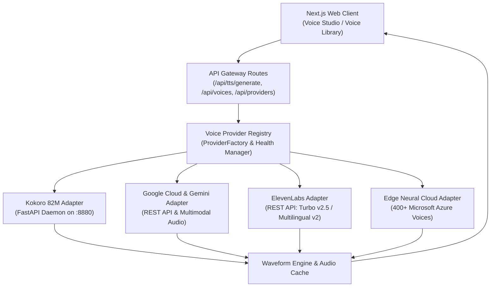

# Multi-Provider AI Voice Platform Architecture

**Document Version:** 2.0  
**Status:** Architecture Specification & Implementation Plan  
**Target Architecture:** Modular, Pluggable, Multi-Provider TTS Platform  

---

## 1. Provider Evaluation Matrix

We evaluate five major AI voice generation engines across speech quality, latency, cost, language support, and deployment complexity:

| Provider | Model Family | Pricing / 1M Chars | Quality & Expressiveness | Latency | Key Strengths | Limitations |
| :--- | :--- | :--- | :--- | :--- | :--- | :--- |
| **Kokoro-82M** | StyleTTS 2 + ISTFTNet (Open Weights) | **$0.00** (Free, Self-Hosted) | ⭐⭐⭐⭐ (4.2/5) High naturalness & prosody at 24kHz | 300–850ms | 100% Free, runs locally, zero cloud dependency, 23 official voices. | Limited to English (US/UK) currently; requires local GPU/CPU inference. |
| **ElevenLabs API** | Eleven Multilingual v2, Turbo v2.5 | **$180 – $300** ($0.18–$0.30 / 1k chars) | ⭐⭐⭐⭐⭐ (4.9/5) Gold standard expressive audio | 250–500ms | Expressive inflection, voice cloning (IVC & PVC), 29+ languages, emotion cues. | Highest cost; requires paid subscription for high volume. |
| **Google Gemini Multimodal Audio** | Gemini 2.0 Flash (Multimodal Audio Output) | **$2.00 – $10.00** / 1M Tokens (~$0.0025 / 1k chars) | ⭐⭐⭐⭐⭐ (4.7/5) Contextual reasoning with natural inflection | 350–700ms | Native emotional intelligence, direct instruction following, 30+ languages. | Newer API; 5 prebuilt character voices (`Puck`, `Charon`, `Kore`, `Fenrir`, `Aoede`). |
| **Google Cloud Text-to-Speech** | Journey, Neural2, Studio, WaveNet | **$16.00 – $160.00** ($0.016–$0.16 / 1k chars) | ⭐⭐⭐⭐ (4.4/5) Broadcast-grade clarity, Journey neural voices | 200–450ms | 220+ voices in 50+ languages, SSML support, Pitch/Rate precision, Studio quality. | Less dramatic voice acting compared to ElevenLabs; requires GCP key. |
| **Microsoft Azure / Edge Neural TTS** | Azure Neural TTS (Edge Engine) | **$0.00 – $15.00** | ⭐⭐⭐⭐ (4.5/5) Production neural speech | 200–400ms | 400+ voices in 100+ languages, zero-cost cloud access out-of-the-box. | Fixed cloud styles; fewer fine-grained voice design dials. |

### Integration Strategy:
1. **Foundation (Self-Hosted):** Kokoro-82M remains the default, instant, zero-cost local provider.
2. **First Additional Real Cloud Provider:** **Google Gemini Multimodal Audio & Google Cloud TTS** + **Edge Neural Cloud TTS** (delivering immediate real multi-language, multi-voice cloud synthesis).
3. **Premier Enterprise Provider:** **ElevenLabs API** with full voice catalogue and slider controls for users with `ELEVENLABS_API_KEY`.

---

## 2. Common TTS Provider Interface

To ensure loose coupling, all providers implement a common contract. The frontend interacts strictly with generic models and never makes direct provider-specific SDK calls.

```typescript
export type ProviderId = 'kokoro' | 'elevenlabs' | 'google_cloud' | 'gemini' | 'edge_tts';

export interface ProviderCapability {
  supportsVoiceCloning: boolean;
  supportsEmotionTags: boolean;
  supportsPitchControl: boolean;
  supportsStabilityControl: boolean;
  supportsSimilarityBoost: boolean;
  supportsStyleExaggeration: boolean;
  supportedFormats: ('wav' | 'mp3' | 'opus' | 'pcm')[];
}

export interface ProviderModelInfo {
  id: string;
  name: string;
  description: string;
  sampleRate: number;
  languages: string[];
  latencyDescription: string;
}

export interface ProviderVoice {
  id: string; // Global unique ID e.g. "kokoro:af_heart" or "elevenlabs:21m00Tcm4TlvDq8ikWAM"
  providerVoiceId: string; // Native provider voice ID e.g. "af_heart"
  providerId: ProviderId;
  name: string;
  category: 'conversational' | 'narration' | 'characters' | 'social_media' | 'cloned';
  gender: 'female' | 'male' | 'non-binary';
  languageCode: string; // e.g. "en-US", "en-GB", "es-ES", "ja-JP", "hi-IN"
  languageName: string;
  accent: string;
  description: string;
  previewUrl: string;
  sampleText: string;
  tags: string[];
  supportedSettings: ('speed' | 'stability' | 'similarity' | 'style' | 'pitch' | 'emotion')[];
  isCloned?: boolean;
}

export interface SynthesizeOptions {
  text: string;
  voice: ProviderVoice;
  settings: {
    speed?: number; // 0.5 - 2.0
    stability?: number; // 0.0 - 1.0 (ElevenLabs, Kokoro)
    similarity?: number; // 0.0 - 1.0 (ElevenLabs)
    styleExaggeration?: number; // 0.0 - 1.0 (ElevenLabs)
    pitch?: number; // -20.0 to +20.0 semitones (Google Cloud)
    emotionInstruction?: string; // (Gemini)
  };
  modelId?: string;
  outputFormat?: 'wav' | 'mp3' | 'opus';
}

export interface SynthesizedAudioResult {
  audioBuffer: Buffer;
  contentType: string; // 'audio/wav' | 'audio/mpeg' | 'audio/opus'
  providerUsed: string;
  durationSeconds: number;
  characterCount: number;
}

export interface IVoiceProvider {
  readonly id: ProviderId;
  readonly name: string;
  readonly description: string;
  readonly isConfigured: boolean;
  readonly requiresApiKey: boolean;
  readonly capabilities: ProviderCapability;

  getModels(): ProviderModelInfo[];
  getVoices(): Promise<ProviderVoice[]>;
  synthesizeSpeech(options: SynthesizeOptions): Promise<SynthesizedAudioResult>;
  getPreview(voiceId: string): Promise<SynthesizedAudioResult>;
  getHealth(): Promise<{ status: 'healthy' | 'degraded' | 'unavailable'; latencyMs?: number; message?: string }>;
}
```

---

## 3. Provider Architecture Diagram



---

## 4. Dynamic Generation Settings Negotiation

Different providers support fundamentally different parameters:

| Setting Key | Kokoro-82M | ElevenLabs | Google Cloud TTS | Google Gemini | Edge Neural |
| :--- | :---: | :---: | :---: | :---: | :---: |
| **Speed (Pacing)** | ✅ 0.5x–2.0x | ✅ 0.5x–2.0x | ✅ 0.25x–4.0x | ✅ Natural | ✅ 0.5x–2.0x |
| **Stability** | ✅ 0.0–1.0 | ✅ 0.0–1.0 | ❌ N/A | ❌ N/A | ❌ N/A |
| **Similarity Boost** | ❌ N/A | ✅ 0.0–1.0 | ❌ N/A | ❌ N/A | ❌ N/A |
| **Style Exaggeration**| ❌ N/A | ✅ 0.0–1.0 | ❌ N/A | ❌ N/A | ❌ N/A |
| **Pitch Shift** | ❌ N/A | ❌ N/A | ✅ -20.0 to +20.0 | ❌ N/A | ✅ -50Hz to +50Hz |
| **Emotion Markup** | ✅ Inline tags | ✅ Contextual | ❌ SSML tags only | ✅ Full Prompt Instructions | ❌ Expressive styles |

**Dynamic UI Behavior:**
When the user switches the active Provider in the Voice Studio, the settings drawer re-renders only the control sliders and knobs that are supported by the active provider. Unsupported controls are hidden to prevent user confusion.

---

## 5. Security & Secret Management

1. **Server-Side Key Isolation:** Provider API keys (`ELEVENLABS_API_KEY`, `GOOGLE_CLOUD_TTS_API_KEY`, `GEMINI_API_KEY`) are stored in server-only environment variables (`.env.local`). No API keys are ever prefixed with `NEXT_PUBLIC_` or transmitted to the client.
2. **Missing Key Handling:** If a cloud provider is unconfigured, the UI displays a clean inline notification ("API key required. Configure in .env.local to activate") without breaking the app.
3. **Prompt Validation:** All prompt text is validated for character length (minimum 1 char, maximum 5,000 chars) and checked for prompt injection.
4. **Attribution & Consent Verification:** Custom voice cloning workflows require explicit legal consent acknowledgments before submission.
