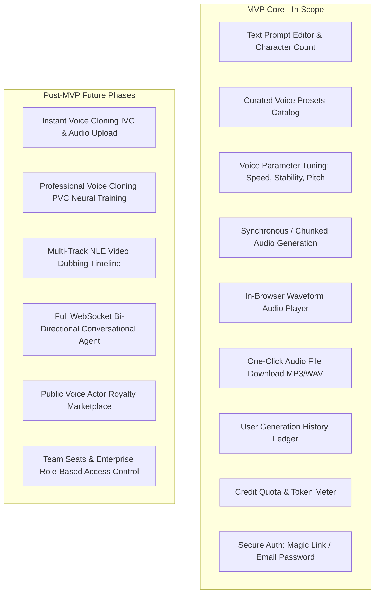
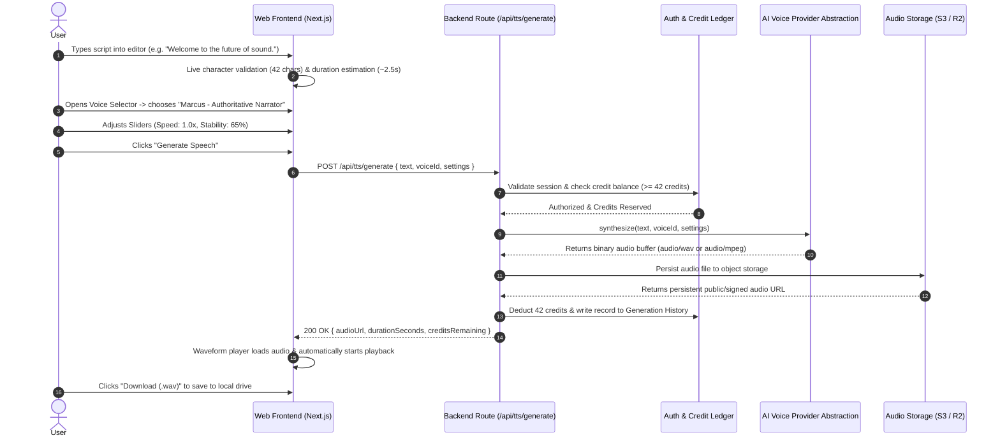

# Product Requirements Document (PRD): Original AI Voice SaaS MVP

**Document Version:** 1.0  
**Status:** Approved for MVP Architecture  
**Author:** Product Architecture Team  
**Last Updated:** October 2026  

---

## 1. Executive Summary & Product Objective

The objective is to build a lean, high-performance, original Software-as-a-Service (SaaS) web platform that democratizes studio-grade synthetic voice generation. The platform enables creators, indie game developers, video producers, and educators to convert written natural language into natural, emotionally resonant human speech in seconds without technical complexity or prohibitive studio recording budgets.

The MVP focuses deliberately on the **core voice generation loop**:
1. **Enter text** into an intuitive editor with length and duration estimations.
2. **Select an AI voice** from a curated library of diverse voice personas.
3. **Configure voice parameters** (speed, stability, emotion/expressiveness).
4. **Generate speech** via an abstracted AI voice generation pipeline.
5. **Preview audio** instantly using an in-browser waveform player.
6. **Download audio files** in standard formats (`.mp3` / `.wav`).
7. **View generation history** with re-usable prompt logs and audio re-downloads.

---

## 2. Target Users & Personas

| Persona | Role & Industry | Key Need & Jobs To Be Done (JTBD) | Current Pain Points |
| :--- | :--- | :--- | :--- |
| **Creator Chris** | Independent Content Creator (YouTube, TikTok, Instagram Reels) | Needs voiceovers for weekly video tutorials and explainer clips within minutes. | Hiring human voice actors costs $100–$300 per session; script revisions require re-booking and take days. |
| **Developer Dana** | Indie Game Developer & Interactive Fiction Writer | Needs 5 to 10 distinct NPC character voices with consistent accents and emotional delivery. | Cannot afford voice actor ensembles; free robotic TTS ruins narrative immersion. |
| **Educator Evan** | Corporate E-Learning & Course Creator | Needs calm, authoritative, multilingual narration for corporate training modules. | Re-recording audio whenever product documentation updates is tedious and inconsistent. |
| **Founder Fiona** | Early-stage Startup Founder | Rapidly prototyping an AI customer service voice bot or marketing demo. | Cloud hyperscaler APIs (AWS Polly, Google Cloud TTS) sound robotic; complex setup with no simple web UI. |

---

## 3. Core Problems Addressed

1. **High Financial & Time Overhead of Human Voiceovers**: Traditional voice talent booking averages \$150–\$500 per finished hour with turnaround times of 48–96 hours.
2. **Robotic Legacy TTS Engines**: Built-in OS synthesizers and older concatenative TTS models lack emotional dynamics, conversational pauses, and prosodic warmth.
3. **Complex Developer-Only Tooling**: High-quality generative neural models exist as low-level APIs or Python scripts without accessible web workstations for non-technical creators.
4. **Fragmented Asset Management**: Users generate audio across disparate tools and lose track of prompt text, voice settings, and previously generated audio files.

---

## 4. MVP Scope: In-Scope vs. Out-of-Scope

---

## 5. User Journeys

### 5.1 Primary Creation Journey (Text-to-Audio)

### 5.2 History & Re-generation Journey
1. User navigates to the **History Tab / Sidebar**.
2. Browses reverse-chronological list of previous generation cards displaying prompt snippet, voice name, creation timestamp, and duration.
3. User can click **Play** to listen immediately without re-generating or consuming credits.
4. User can click **Reuse Prompt** to populate the active studio editor with the exact text and voice settings of that past generation.
5. User can click **Download** to retrieve the cached audio file.

### 5.3 Quota Depletion Journey
1. User enters text exceeding their remaining monthly credit balance (e.g., has 150 credits left, attempts 500 characters).
2. The UI disables the "Generate Speech" button and highlights the credit meter in amber/red.
3. A clear modal surfaces: *"You need 500 credits for this generation (Current balance: 150). Upgrade to Starter or wait for monthly renewal."*
4. Provides direct link to `/pricing`.

---

## 6. Functional Requirements

| ID | Requirement Category | Detailed Specification | Acceptance Criteria |
| :--- | :--- | :--- | :--- |
| **FR-01** | Text Input | Provide a multi-line auto-expanding textarea supporting 1 to 5,000 characters per single generation. | Real-time character counter displays `current / 5000`. Button disabled when empty or $>5000$. |
| **FR-02** | Voice Preset Catalog | Present a minimum of 8 curated, diverse voice presets (covering Male, Female, American, British, Narrative, and Conversational). | Each voice card displays name, accent, gender, use-case tag, and a 3-second sample preview audio button. |
| **FR-03** | Voice Tuning Controls | Provide interactive adjustment sliders for: Speed ($0.5\times$ to $2.0\times$), Stability / Tone ($0\%$ to $100\%$), and Style / Exaggeration ($0\%$ to $100\%$). | Default values pre-set to balanced baseline (Speed: 1.0, Stability: 0.5); values passed in generation payload. |
| **FR-04** | Audio Generation | Client submits generation request to backend API. Backend delegates to the active provider via provider abstraction. | Displays loading spinner and disables generate button during generation; handles errors gracefully with actionable toasts. |
| **FR-05** | Audio Preview Player | Embed an interactive waveform player rendering the generated audio buffer. | Supports Play/Pause, spacebar shortcut, click-to-seek progress bar, elapsed/total time, and playback speed cycle ($0.8\times, 1.0\times, 1.25\times, 1.5\times$). |
| **FR-06** | Audio Download | Provide single-click download of the generated audio file. | File downloads to user filesystem named `voxcraft-[voice]-[timestamp].[mp3/wav]`. |
| **FR-07** | Generation History | Persist all completed generations in database tied to the authenticated user ID. | History panel displays latest 20 generations; includes audio playback, prompt copy button, and download link. |
| **FR-08** | Credit Ledger | Allocate 10,000 free starter credits upon account creation. Deduct 1 credit per text character generated. | User balance updates immediately post-generation; deduction is atomic. |
| **FR-09** | Authentication | Support email + password and Google OAuth login/registration. | User session persists via secure HTTP-only JWT cookies; unauthenticated requests to protected endpoints return 401. |
| **FR-10** | Error Handling | Surface clear user-facing messages for network timeouts, provider downtime, or invalid inputs. | Server errors never dump raw stack traces or leaked provider API keys to the browser. |

---

## 7. Non-Functional Requirements

### 7.1 Performance & Latency
- **Time to First Audio (TTFA)**: For short prompts ($\le 150$ characters), total turnaround time from click to audio preview must be $\le 2.5$ seconds.
- **Client Bundle Size**: Initial First Contentful Paint (FCP) $\le 1.2$ seconds on a 4G connection; first-load shared JavaScript bundle $\le 120$ KB.
- **Audio Playback Startup**: Audio playback initiates within $100$ms of clicking Play via Web Audio API pre-buffering.

### 7.2 Scalability & Reliability
- **Stateless Web Layer**: Next.js API routes must remain fully stateless to scale horizontally behind a load balancer or serverless edge container.
- **Storage Durability**: All generated audio files stored with 99.999999999% (11 9's) durability on object storage (Cloudflare R2 or AWS S3).
- **Graceful Provider Fallback**: If the primary cloud voice provider experiences an outage or rate-limit ($429$), the backend can failover to a backup provider without frontend application crashes.

### 7.3 Security & Privacy
- **API Key Isolation**: Cloud voice provider credentials (`ELEVENLABS_API_KEY`, `DEEPGRAM_API_KEY`, etc.) must **never** be transmitted to the browser or included in client bundle manifests. All calls route through server-side endpoints.
- **Data Protection**: User script text and generated audio files must be private to the creating user, enforced via Row Level Security (RLS) in the database.
- **Transport Security**: Mandatory TLS 1.3 encryption across all client-to-server and server-to-provider communications.

### 7.4 Usability & Accessibility (WCAG 2.1 AA)
- Keyboard navigability for all interactive controls (Tab, Enter, Spacebar for audio play/pause, Arrow keys for sliders).
- High-contrast visual indicators for dark and light theme palettes.
- Mobile-responsive layout adapting seamlessly from 375px mobile screens to 4K ultrawide desktop monitors.
