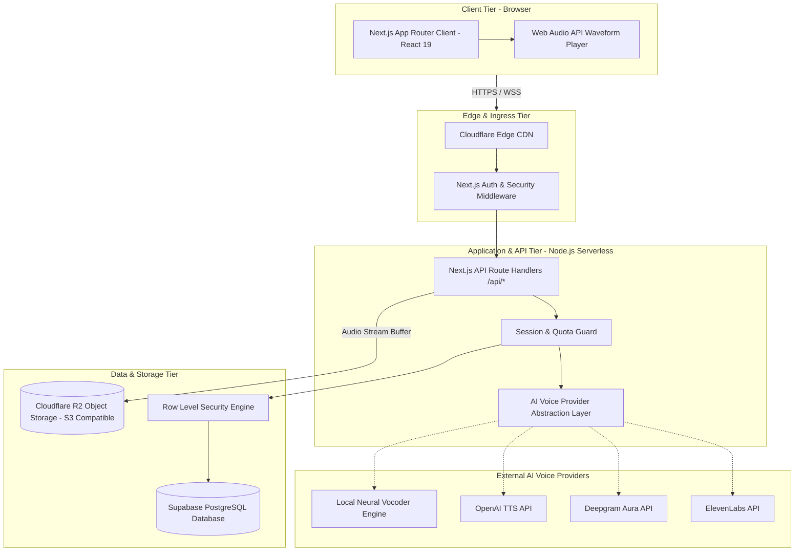
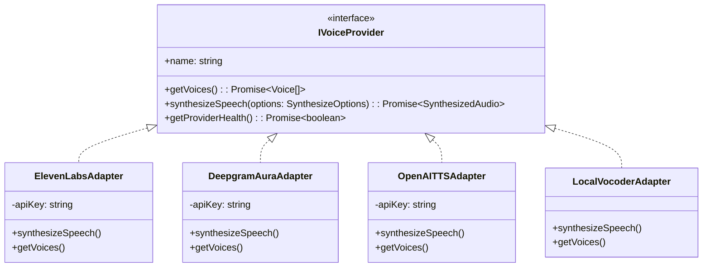

# Technical Architecture & Systems Design: Original AI Voice SaaS MVP

**Document Version:** 1.0  
**Status:** Architectural Recommendation  
**Author:** Principal Software Architect  
**Last Updated:** October 2026  

---

## 1. System Architecture Overview

The system is designed as a modular, cloud-native fullstack application engineered for rapid MVP delivery, low operational expenditure (OpEx), and seamless scalability. The architecture couples a high-performance **Next.js (App Router)** frontend and API tier with an **AI Voice Provider Abstraction Layer**, backed by **Supabase (PostgreSQL)** for relational data and transactional credit accounting, and **Cloudflare R2** for zero-egress audio asset delivery.



---

## 2. Technology Evaluations & Recommendations

### 2.1 Framework: Next.js with TypeScript
- **Options Evaluated**:
  1. *Next.js (App Router) with TypeScript* (Recommended)
  2. *Single Page App (Vite + React) + Separate Express.js / Fastify Backend*
- **Comparative Analysis**:
  - A separate backend incurs duplicate TypeScript type definitions, CORS configuration hurdles, two distinct deployment pipelines, and higher cold idle hosting costs.
  - Next.js App Router provides unified end-to-end type safety, Server Actions, built-in Route Handlers (`/api/*`), edge middleware, and optimal Search Engine Optimization (SEO) for public voice catalog and marketing landing pages.
- **Architectural Decision**: **Next.js 15+ with TypeScript**. One cohesive codebase running on standard Node.js or serverless edge infrastructure.

---

### 2.2 Styling & Design System: Tailwind CSS + Radix / shadcn
- **Options Evaluated**:
  1. *Tailwind CSS with Headless UI Primitives* (Recommended)
  2. *CSS Modules / Styled Components*
- **Comparative Analysis**:
  - CSS-in-JS libraries introduce runtime hydration overhead and break React Server Component streaming.
  - Tailwind CSS compiles down to minimal atomic utility classes with zero main-thread runtime overhead, built-in responsive breakpoints, and straightforward dark/light mode token management.
- **Architectural Decision**: **Tailwind CSS + headless accessible UI primitives** for fast, accessible, lightweight component composition.

---

### 2.3 Backend Strategy: Next.js API Routes vs. Standalone Node.js Microservice
- **Options Evaluated**:
  1. *Next.js Serverless Route Handlers* (Recommended for MVP)
  2. *Standalone Node.js / Express Server on a dedicated container / VPS*
- **Comparative Analysis**:
  - For the MVP scope (synchronous TTS text conversion, audio streaming, and database lookups), Next.js API Route Handlers are more than sufficient, scaling automatically to zero and costing \$0 during idle periods.
  - A standalone containerized backend is only justified when long-lived background render queues (e.g. 2-hour audiobook rendering or heavy FFMPEG video dubbing) or persistent raw WebRTC/SIP connections are required.
- **Architectural Decision**: **Next.js API Route Handlers** for MVP. Maintain clean modular service layers (`src/services/*`) so heavy background tasks can easily be extracted into a separate BullMQ / Node.js worker service in Phase 4 without frontend refactoring.

---

### 2.4 Database: Supabase (PostgreSQL) vs. MongoDB
- **Options Evaluated**:
  1. *Supabase (PostgreSQL with Row Level Security)* (Strongly Recommended)
  2. *MongoDB (NoSQL Document Store)*

| Evaluation Criteria | Supabase (PostgreSQL) | MongoDB Atlas |
| :--- | :--- | :--- |
| **Data Integrity for Credit Ledgers** | **Superior (ACID Guaranteed)**: Supports row-level locks and atomic conditional updates (`balance = balance - cost WHERE balance >= cost`). | Requires manual document-level distributed transactions which can suffer concurrency conflicts. |
| **Row Level Security (RLS)** | **Native**: Authorization policies enforced directly at the SQL engine level. | Requires custom application-level middleware on every query. |
| **Relational Data Mapping** | **Optimal**: Clean Foreign Key relationships (`Users` $\to$ `Voices` $\to$ `Generations` $\to$ `Transactions`). | Denormalized nested arrays can become unwieldy as history grows to thousands of items. |
| **Free / Starter Tier Value** | Generous 500MB DB, 50,000 monthly active users, included auth and edge functions. | 512MB shared cluster with connection limits and separate auth system needed. |

- **Architectural Decision**: **Supabase (PostgreSQL)**. Financial accounting (user credits and billing transactions) requires strict relational ACID guarantees.

---

### 2.5 Authentication & Identity
- **Recommendation**: **Supabase Auth** or **NextAuth.js (Auth.js v5)**.
  - Binds directly with PostgreSQL `auth.users` tables.
  - Provides out-of-the-box support for Email Magic Links, standard Email/Password, and Google OAuth 2.0.
  - Session tokens stored as secure, `HttpOnly`, `SameSite=Lax` cookies, preventing XSS-based token theft.

---

### 2.6 Audio Asset Storage: Cloudflare R2 vs. AWS S3 vs. Supabase Storage
- **Options Evaluated**:
  1. *Cloudflare R2 (S3-Compatible Object Storage)* (Strongly Recommended)
  2. *AWS S3 (Amazon Web Services)*
  3. *Supabase Storage*
- **Egress Economics Comparison**:
  - In an audio SaaS, users constantly stream, replay, and download 2MB–10MB audio files.
  - **AWS S3**: \$0.09 per GB egress. Serving 10,000 active users streaming audio results in massive unpredictable egress bandwidth invoices.
  - **Cloudflare R2**: **\$0.00 egress bandwidth fees**. Storage is billed at a flat \$0.015/GB-month.
- **Architectural Decision**: **Cloudflare R2** (using the standard `@aws-sdk/client-s3` client). In development / zero-setup mode, base64 data URLs or local filesystem caching can be used as a zero-dependency fallback.

---

## 3. AI Voice Provider Abstraction Layer

To ensure the SaaS is never locked into a single commercial vendor or crippled by third-party price increases, all voice synthesis is mediated through an **Adapter Pattern interface**.



### Provider Contract Specification:
```typescript
export interface SynthesizeOptions {
  text: string;
  voiceId: string;
  speed: number;       // 0.5 to 2.0
  stability?: number;   // 0.0 to 1.0 (if supported)
  similarity?: number;  // 0.0 to 1.0 (if supported)
}

export interface SynthesizedAudio {
  audioBuffer: Buffer;
  contentType: 'audio/mpeg' | 'audio/wav';
  durationSeconds: number;
  providerName: string;
}

export interface IVoiceProvider {
  readonly id: string;
  readonly name: string;
  getVoices(): Promise<VoicePreset[]>;
  synthesizeSpeech(options: SynthesizeOptions): Promise<SynthesizedAudio>;
}
```

---

## 4. Security & Secret Isolation Strategy

> [!CAUTION]
> **Zero-Exposure Credential Policy**:
> AI Voice Provider keys (e.g. `ELEVENLABS_API_KEY`, `DEEPGRAM_API_KEY`) possess direct spending authority. They must **never** be exposed in client-side bundles, public GitHub repos, or browser network responses.

1. **Server-Only Guards**: Enforce Next.js `import "server-only"` on all provider modules to guarantee compile-time failure if a provider is accidentally imported into a client component.
2. **Reverse Proxying**: The browser calls internal endpoints (`/api/tts/generate`), never provider endpoints directly.
3. **Environment Isolation**: Production secrets managed via Vercel / Cloudflare encrypted environment stores, never committed to `.env` in git.

---

## 5. Usage & Credit Management Architecture

To prevent race conditions, overdrafts, and credit exploit loops:
1. **Double-Entry Transaction Ledger**:
   - `profiles.credits_balance`: Fast read cache of current credit balance.
   - `credit_transactions`: Immutable write-ahead audit log recording every single debit and credit.
2. **Atomic SQL Deductions**:
   ```sql
   -- Deduct credits atomically in a single query; fails if balance is insufficient
   UPDATE profiles
   SET credits_balance = credits_balance - $amount
   WHERE id = $user_id AND credits_balance >= $amount
   RETURNING credits_balance;
   ```
   If no rows are updated, the backend immediately halts and returns HTTP 402 (Payment Required / Quota Exceeded).

---

## 6. End-to-End Latency & Performance Architecture

| Optimization Layer | Implementation Mechanism | Latency Impact |
| :--- | :--- | :--- |
| **Audio Chunk Streaming** | Backend streams audio chunks via `Transfer-Encoding: chunked` directly to Web Audio API as bytes arrive from provider. | Reduces perceived Time to First Sound (TTFS) from 4s to <500ms. |
| **Response Caching (Deduplication)** | Computes SHA-256 hash of `(text + voice_id + settings)`. If match exists in database, returns cached R2 URL immediately. | Reduces latency to <80ms and incurs $0 inference cost. |
| **Edge Asset Distribution** | Static UI assets and pre-rendered marketing pages served from Cloudflare / Vercel Edge CDN nodes worldwide. | FCP $\le 800$ms globally. |
