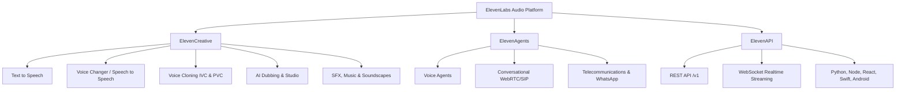
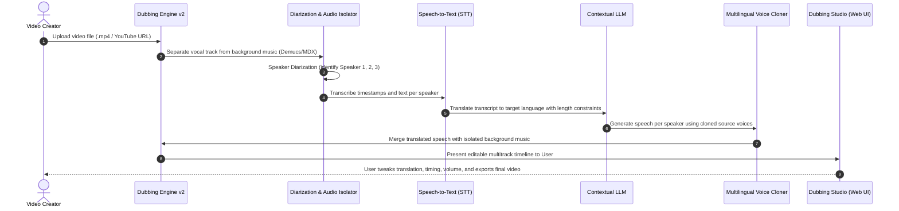

# ElevenLabs Product Feature Breakdown & Capabilities Matrix

**Subject:** Deep-dive analysis of core product pillars, underlying model capabilities, voice cloning technologies, audio processing pipelines, and commercial pricing models.  
**Source Evidence:** Official ElevenLabs product interfaces (`/text-to-speech`, `/voice-changer`, `/voice-cloning`, `/dubbing`, `/pricing`) captured via REA MCP tools.

---

## 1. Core Product Pillars Overview

ElevenLabs has transitioned from a standalone text-to-speech engine into a full-spectrum generative audio platform organized across three primary umbrellas:
1. **ElevenCreative**: Media production tools for creators, game developers, authors, and studios.
2. **ElevenAgents**: Ultra-low-latency conversational AI and telephone agents.
3. **ElevenAPI**: Programmatic interfaces, WebSockets, and SDKs for software developers.

---

## 2. Deep Dive: The 6 Audio Generation Pillars

### 2.1 Text to Speech (TTS)
The foundational technology converting arbitrary natural language text into lifelike spoken audio.

- **Underlying Model Generations (Observed & Publicly Documented)**:
  - **Eleven v4 (Latest Flagship Release)**: Full emotional range conditioning, expressive speech layered with spontaneous audio events (laughs, sighs, whispers), and contextual prosody.
  - **Eleven v3 / Multilingual v2**: Stable cross-lingual synthesis across 32+ to 90+ languages; high phoneme accuracy and accent preservation.
  - **Turbo v2.5**: Sub-250ms first-chunk generation time; optimized for real-time conversational agents and interactive gaming.
- **Synthesis Tuning Controls**:
  - `Stability`: Slider balancing consistency against emotional variation. Low stability yields high drama and spontaneous inflection; high stability yields uniform narration.
  - `Similarity Boost / Clarity`: Adjusts adherence to the original reference voice profile. High values increase fidelity to the clone at the risk of reproducing sample background noise.
  - `Style Exaggeration`: Amplifies the stylistic nuances and energetic delivery of the speaker.
  - `Speaker Boost`: Enhances presence and projection in noisy mix environments.
  - `Speech Markup & Inline Emotion Tags`: Directly interprets contextual markdown tokens such as `[whispers]`, `[sarcastically]`, `[laughs warmly]`, `[softly]`, and `[sighs contentedly]`.
- **Supported Audio Formats & Bitrates**:
  - MP3 (44.1kHz up to 192kbps).
  - Uncompressed PCM / WAV (16-bit, 22.05kHz, 24kHz, and 44.1kHz on Pro+ plans).
  - μ-law / A-law (8kHz) for telephony and IVR pipelines.

---

### 2.2 Speech to Speech (STS) / Voice Changer
Transforms source voice recordings into another voice identity while preserving timing, pauses, emotional intensity, and inflections.

- **Mechanism**:
  - Strips the acoustic identity (timbre, formant signature, pitch baseline) of the speaker.
  - Retains the prosodic envelope, rhythmic cadence, whispering, laughing, and breathing cues.
  - Re-synthesizes the vocal stream through the target voice embedding.
- **Differentiating Factor vs. Conventional TTS**:
  - In TTS, the AI infers prosody and punctuation from text alone.
  - In STS, the human director controls the exact comedic timing, hesitation, dramatic shouting, or subtle emotional inflection with their own voice.

---

### 2.3 Voice Library & Marketplace
A global marketplace where creators and voice actors publish AI voice profiles.

- **Library Dimensions**: 17,500+ curated and community voices.
- **Taxonomy & Filtering Hierarchy**:
  - *Use Case*: Narration & Story, Conversational, Character / Animation, Social Media, Educational, Advertisement & Entertainment.
  - *Demographics*: Gender (Male, Female, Non-binary), Age (Young, Middle Aged, Old).
  - *Accent & Language*: American, British, Canadian, Australian, Indian, Nigerian, Spanish, Japanese, German, etc.
- **Creator Monetization (Payout Program)**:
  - Voice contributors license their voice profiles.
  - Every time another user generates characters using that voice, the voice owner accrues financial royalties or credit shares.

---

### 2.4 Voice Cloning: Instant vs. Professional

ElevenLabs maintains a strict two-tier voice cloning architecture to address distinct latency, fidelity, and security requirements:

| Dimension | Instant Voice Cloning (IVC) | Professional Voice Cloning (PVC) |
| :--- | :--- | :--- |
| **Input Data Requirement** | 10 seconds to 2 minutes of clean audio | 30 minutes to 3 hours of studio-grade audio |
| **Turnaround Time** | Immediate (sub-5 seconds processing) | 2 to 4 hours (asynchronous training job) |
| **Underlying Technique** | Zero-shot reference voice latent embedding | Dedicated fine-tuned neural model weights |
| **Acoustic Fidelity** | Good for general voiceovers; minor artifacts | Hyper-realistic, indistinguishable from original |
| **Accent & Idiosyncrasy** | Replicates general timbre and pitch | Captures micro-inflections, lisp, and vocal fry |
| **Plan Availability** | Available on Starter plan ($5/mo) and above | Restricted to Creator plan ($22/mo) and above |
| **Verification & Security** | Basic terms agreement | **Mandatory Voice Captcha**: User must record a dynamic prompt in their own voice to verify identity |

---

### 2.5 AI Dubbing & Localization
An end-to-end multi-modal pipeline for translating and re-voicing video content across 90+ languages.

- **Dubbing v2 Innovations**: Conditions on the acoustic performance of the source speaker rather than a flat transcript, allowing laughs, sighs, and pauses to translate natively.
- **Dubbing Studio**: A browser-based non-linear editor (NLE) providing word-level timing adjustments, volume leveling, background sound preservation, and manual translation overrides.

---

### 2.6 Audio Generation: Sound Effects, Music & Studio
- **Text to Sound Effects (SFX)**:
  - Generates ambient sounds, cinematic risers, foley, footsteps, impact noises, and environmental backdrops from natural language prompts.
- **AI Music Generator**:
  - Generates full-length studio quality tracks (vocal or instrumental) across diverse genres (ambient, cinematic, pop, hip-hop, orchestral).
- **ElevenLabs Studio**:
  - A long-form content workstation specifically engineered for audiobooks, multi-character audio dramas, and episodic podcasts.
  - Supports multi-paragraph block layouts, paragraph-level voice assignments, pauses insertion (`<break time="1.5s" />`), and batch rendering.

---

## 3. Commercial Pricing & Subscription Tier Matrix

Data collected directly from ElevenLabs pricing audit (`/pricing`):

| Plan | Monthly Price | Monthly Credits | Quota Equivalent | Distinctive Features |
| :--- | :--- | :--- | :--- | :--- |
| **Free** | **$0** | 10,000 | ~10 mins audio | Non-commercial license, attribution required, standard TTS/STT, 3 Studio projects. |
| **Starter** | **$5/mo** ($1 first mo) | 30,000 | ~30 mins audio | **Commercial License**, Instant Voice Cloning (IVC), 20 Studio projects, Dubbing Studio access. |
| **Creator** | **$22/mo** ($11 first mo) | 121,000 | ~2 hours audio | **Professional Voice Cloning (PVC)**, overage credit purchases enabled, higher concurrency. |
| **Pro** | **$99/mo** | 600,000 | ~10 hours audio | **44.1kHz PCM uncompressed audio output**, 192kbps MP3s, commercial audiobooks, priority queue. |
| **Scale** | **$299/mo** | 1,800,000 | ~30 hours audio | **3 Workspace seats**, 3 Professional Voice Clones, team collaboration, consolidated billing. |
| **Business** | **$990/mo** | 6,000,000 | ~100 hours audio | **10 Workspace seats**, 10 Professional Voice Clones, ultra-low latency TTS as low as $0.05/minute. |
| **Enterprise** | **Custom** | Custom | Custom volume | Custom SSO, HIPAA BAAs, dedicated account manager, elevated concurrency, SLA assurances. |

---

## 4. Key Takeaways for SaaS Competitors
1. **The "Free to Hook, Tiered to Scale" Funnel**: The 10k free credit tier acts as a frictionless customer acquisition channel; the $1 first-month promotional pricing eliminates barrier to entry for paid conversion.
2. **Feature Gating by Economic Risk**:
   - High-compute features (PVC training) are gated behind Creator ($22/mo) to prevent free-tier GPU exhaustion.
   - High-bandwidth features (uncompressed 44.1kHz PCM) are gated behind Pro ($99/mo).
3. **Multi-Seat Enterprise Expansion**: Scale and Business tiers shift the value proposition from raw character counts to team collaboration, shared voice libraries, and seat management.
