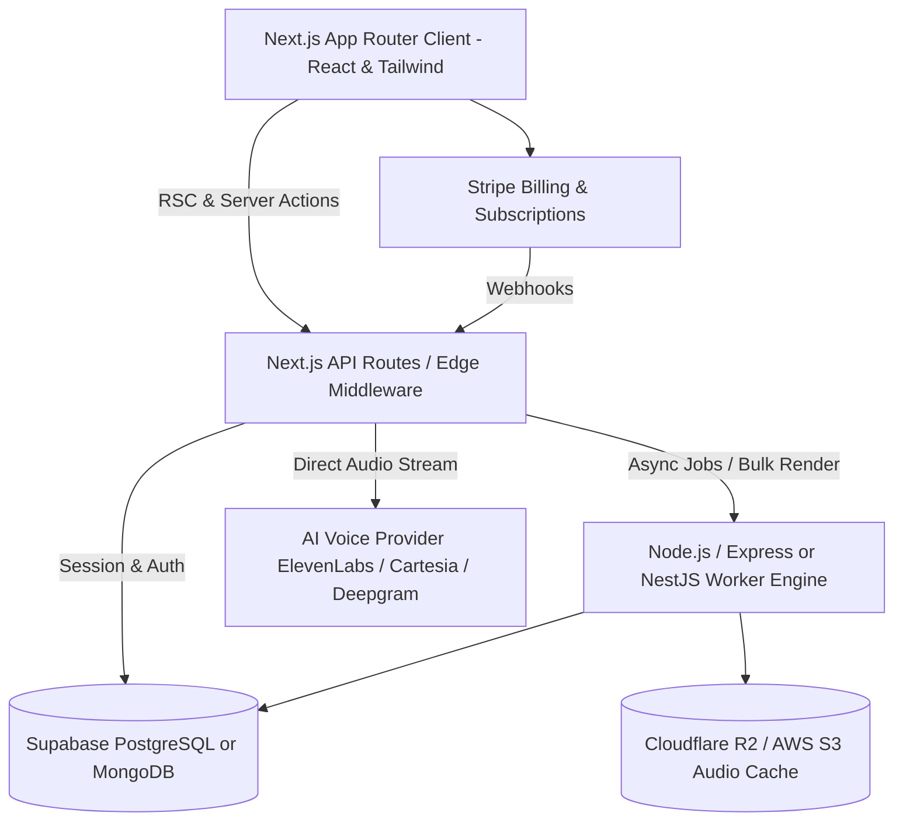

# MVP Architecture & Product Roadmap: Original AI Voice SaaS

**Product Vision:** A modern, high-performance generative AI voice workstation and developer platform built with Next.js, React, Tailwind CSS, Node.js, Supabase/MongoDB, and a high-fidelity AI voice provider API.

---

## 1. Architecture Overview & Recommended Tech Stack



### Stack Components:
- **Frontend / Fullstack Framework**: **Next.js (App Router, React 19)**
  - Server Components for instant initial paint, SEO, and secure server-to-server API communication.
  - Client components for interactive audio visualizers, sliders, and audio players.
- **Styling & UI**: **Tailwind CSS + shadcn/ui (Radix Primitives)**
  - Clean, accessible components with built-in dark/light mode and custom sliders.
- **Application Backend**: **Next.js Server Actions / API Routes + Node.js Worker**
  - Node.js handles heavy audio chunk processing, FFMPEG slicing, and long-running batch renders.
- **Database**: **Supabase (PostgreSQL)** *(Recommended over MongoDB)*
  - PostgreSQL provides transactional integrity for credit ledgers, ACID guarantees on quota deductions, and built-in Row-Level Security (RLS) with Supabase Auth.
- **Storage**: **Cloudflare R2**
  - Zero egress fees for high-volume audio file downloads and playback.
- **AI Voice Provider**:
  - Primary Provider: **ElevenLabs API** (for maximum realism and voice library breadth) or **Cartesia Sonic** / **Deepgram Aura** (for ultra-low-latency <150ms real-time conversational streaming).
  - Open Source Fallback: **Kokoro-82M** or **XTTS v2** hosted on Modal / RunPod for cost-effective baseline synthesis.

---

## 2. Phased Implementation Roadmap

### Phase 1: MVP Core (TTS Studio, Auth & Billing)
**Goal:** Launch a fully functional Text-to-Speech web studio with credit-based monetization within 4 weeks.

- **Milestone 1.1: Authentication & User Workspace**
  - Supabase Auth supporting Google OAuth and Email Magic Links.
  - Automatically allocate 10,000 free starter credits upon registration.
- **Milestone 1.2: Core TTS Studio Interface**
  - Text editor with character count validation and estimated audio duration calculator.
  - Voice selector modal with audio sample previews, filtered by gender, accent, and style.
  - Parameter controls: Stability, Clarity/Similarity, Style Exaggeration, and Speed sliders.
- **Milestone 1.3: Audio Streaming Player**
  - Web Audio API integration with visual waveform (Wavesurfer.js).
  - Stream audio chunks via `ReadableStream` directly to the client for immediate playback.
  - Export generated speech as `.mp3` or `.wav`.
- **Milestone 1.4: Stripe Subscription & Credit Ledger**
  - Stripe Checkout integration for Starter ($9/mo, 50k credits) and Pro ($29/mo, 200k credits).
  - Webhook listener to handle renewals, cancellations, and quota top-ups.
  - Atomic credit deduction per generation (`credits = characters_generated`).

---

### Phase 2: Instant Voice Cloning & Voice Marketplace
**Goal:** Enable users to clone their own voices and discover community voices.

- **Milestone 2.1: Instant Voice Cloning (IVC)**
  - Audio recording widget in the browser using `MediaRecorder` API or drag-and-drop file uploader (WAV/MP3).
  - Audio noise gate / cleaner to verify minimum sample quality (minimum 15 seconds, low background noise).
  - Forward sample to Voice Provider's voice creation endpoint; receive and persist unique `voice_id`.
- **Milestone 2.2: Custom Voice Library & Tags**
  - Personal voice management dashboard (rename, adjust default settings, delete).
  - Public Voice Marketplace: users can opt into sharing their voice and earn credit royalties.
  - Search by accent, mood, gender, and language.

---

### Phase 3: Real-Time WebSocket Streaming & Conversational Voice Agent
**Goal:** Build low-latency conversational audio capabilities for developers and enterprise use cases.

- **Milestone 3.1: WebSocket Real-Time TTS Bridge**
  - Establish persistent WebSocket connections between client and provider via Node.js proxy.
  - First-chunk audio latency reduced to sub-250ms for conversational pacing.
- **Milestone 3.2: Voice Agent Playground Widget**
  - Integrate STT (Whisper / Deepgram) + LLM (Claude 3.5 Sonnet / GPT-4o-mini) + TTS streaming pipeline.
  - Embeddable web widget for conversational customer service bots.

---

### Phase 4: Long-Form Multi-Speaker Studio & Video Dubbing
**Goal:** Support complex creator workflows (audiobooks, podcasts, video translation).

- **Milestone 4.1: Multi-Speaker Script Editor**
  - Block-based document editor where each paragraph can be assigned a distinct voice actor.
  - Custom pause / silence insertion tokens (`<break time="2.0s" />`).
  - Batch generation with unified multi-track timeline export.
- **Milestone 4.2: Automated AI Dubbing**
  - Video upload pipeline with FFMPEG audio extraction.
  - Automated transcription, translation, and voice-matched re-synthesis.
  - Dubbing timeline review interface for subtitle and timing adjustments.

---

## 3. Database Schema Design (PostgreSQL / Supabase)

```sql
-- Users & Workspaces
CREATE TABLE profiles (
    id UUID PRIMARY KEY REFERENCES auth.users(id) ON DELETE CASCADE,
    email TEXT NOT NULL,
    full_name TEXT,
    created_at TIMESTAMPTZ DEFAULT NOW(),
    stripe_customer_id TEXT,
    subscription_tier TEXT DEFAULT 'free', -- 'free', 'starter', 'pro', 'enterprise'
    credits_balance INTEGER DEFAULT 10000,
    credits_reset_at TIMESTAMPTZ DEFAULT (NOW() + INTERVAL '1 month')
);

-- Voice Profiles (Stock & Cloned)
CREATE TABLE voices (
    id UUID PRIMARY KEY DEFAULT gen_random_uuid(),
    user_id UUID REFERENCES profiles(id) ON DELETE SET NULL, -- NULL for stock voices
    external_voice_id TEXT NOT NULL, -- Provider voice ID
    name TEXT NOT NULL,
    category TEXT NOT NULL, -- 'narration', 'conversational', 'characters', 'cloned'
    language TEXT DEFAULT 'en',
    accent TEXT,
    gender TEXT,
    preview_url TEXT,
    is_public BOOLEAN DEFAULT FALSE,
    created_at TIMESTAMPTZ DEFAULT NOW()
);

-- Speech Generation Records
CREATE TABLE generations (
    id UUID PRIMARY KEY DEFAULT gen_random_uuid(),
    user_id UUID NOT NULL REFERENCES profiles(id) ON DELETE CASCADE,
    voice_id UUID NOT NULL REFERENCES voices(id),
    prompt_text TEXT NOT NULL,
    characters_count INTEGER NOT NULL,
    model_id TEXT NOT NULL,
    audio_url TEXT NOT NULL,
    duration_seconds NUMERIC(6,2),
    created_at TIMESTAMPTZ DEFAULT NOW()
);

-- Credit Transactions & Audit Ledger
CREATE TABLE credit_transactions (
    id UUID PRIMARY KEY DEFAULT gen_random_uuid(),
    user_id UUID NOT NULL REFERENCES profiles(id) ON DELETE CASCADE,
    amount INTEGER NOT NULL, -- Negative for deductions, positive for refills
    balance_after INTEGER NOT NULL,
    reason TEXT NOT NULL, -- 'tts_generation', 'monthly_refill', 'stripe_purchase'
    created_at TIMESTAMPTZ DEFAULT NOW()
);
```

---

## 4. API Endpoints Specification

### 4.1 Public Client API
- `POST /api/tts/stream`: Streams audio bytes directly to the client.
  - *Input*: `{ voice_id, text, model_id, settings: { stability, similarity_boost, style } }`
  - *Output*: `Transfer-Encoding: chunked` audio stream (`audio/mpeg`).
- `GET /api/voices`: Returns available stock and user-cloned voices with filtering.
- `POST /api/voices/clone`: Uploads sample audio and registers an Instant Voice Clone.
- `GET /api/user/credits`: Returns current credit balance and renewal schedule.

### 4.2 Webhooks & Internal
- `POST /api/webhooks/stripe`: Ingests `checkout.session.completed` and `invoice.payment_succeeded` events to adjust subscription tiers and refill credit balances.

---

## 5. Cost Analysis & Gross Margin Architecture

| Operational Expense | Cost Benchmark | Customer Retail Pricing | Gross Margin |
| :--- | :--- | :--- | :--- |
| **API Inference Cost** | ~$0.15 to $0.25 per 10k chars (via Provider API) | $0.60 to $1.20 per 10k chars | **60% – 75%** |
| **Edge Compute & Vercel** | ~$20/mo baseline + bandwidth | Covered in SaaS subscription overhead | N/A |
| **Cloudflare R2 Storage** | $0.015/GB/mo (0 egress cost) | Minimal audio file footprints | **95%+** |
| **Database & Auth (Supabase)** | $25/mo Pro tier | Supports first 10,000 MAUs | N/A |

### Margin Optimization Strategy:
1. **Model Routing**: Route simple or fast preview text to smaller/cheaper models (e.g. Turbo models or local open-source models) and reserve premier models (e.g. Eleven v4) for final export.
2. **Audio Cache Deduplication**: Hash the `(text + voice_id + settings)` tuple with SHA-256. If an identical generation is requested, serve the cached R2 audio file instantly without incurring provider API costs.
