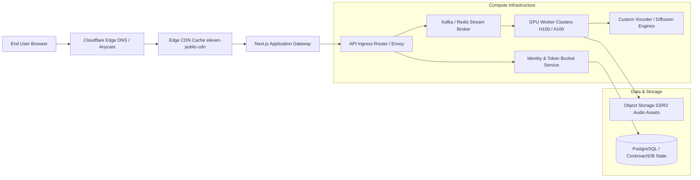

# Technical Architecture & Systems Engineering Observations: ElevenLabs

**Subject:** Architectural, infrastructure, network, audio streaming, and security assessment based on empirical observation of [https://elevenlabs.io](https://elevenlabs.io) via REA MCP tools.

---

## 1. Frontend Systems Architecture

### 1.1 Next.js App Router & React Server Components (RSC)
- **Observation**:
  - The page layout is delivered with streaming RSC flight scripts:
    ```html
    <script>(self.__next_f=self.__next_f||[]).push([0])</script>
    ```
  - Static HTML shell is server-rendered on the edge, enabling immediate First Contentful Paint (FCP) and near-zero layout shifts.
- **Client Hydration Strategy**:
  - Only interactive islands (the voice sample players, tab panels, and navigation flyouts) are hydrated with client-side JavaScript.
  - The static marketing copy, testimonials, and footer links remain server-rendered HTML nodes, keeping the main-thread hydration budget extremely lean.

### 1.2 Design System & Component Engineering
- **Component Foundations**: Built on **React Aria** headless accessibility components (`@react-aria/pressable`, `@react-aria/button`). This provides rock-solid keyboard navigation, screen reader compliance, and multi-touch support.
- **Styling Architecture**: **Tailwind CSS** with a mandatory namespace prefix (`tw-`).
  - *Engineering Rationale*: Prefixing all utility classes (e.g. `tw-flex`, `tw-font-medium`, `tw-rounded-card`) isolates the marketing application from potential style bleed caused by injected widgets (e.g., Cookiebot cookie banners, Zendesk chat widgets, Stripe Elements).
- **Typography Layout Engine**:
  - Preloads critical `.woff2` files with `crossorigin=""`.
  - Implements custom `@font-face` fallback definitions with exact `size-adjust`, `ascent-override`, and `descent-override` calculations matching system `Arial` and `Times New Roman` fonts, completely suppressing font swap layout shifts.

### 1.3 Edge Speculation & Prerendering
- **Speculation Rules API**:
  Observed in the page `<head>`:
  ```json
  {
    "prerender": [
      {
        "source": "document",
        "eagerness": "eager",
        "where": { "href_matches": "/app/sign-up*" }
      }
    ],
    "prefetch": [
      {
        "where": { "href_matches": "/app/*" },
        "eagerness": "eager"
      }
    ]
  }
  ```
  - **Impact**: When the user scrolls or hovers near a registration trigger, the browser has already initiated background rendering of `/app/sign-up`. The transition feels instantaneous, boosting user activation metrics.

---

## 2. Audio Streaming & Media Delivery Pipelines

### 2.1 Audio Playback Architecture
- **In-Browser Audio Engine**:
  - Employs the browser **Web Audio API** (`AudioContext`, `GainNode`, and `AudioBufferSourceNode`) rather than simple `<audio>` HTML elements for interactive voice previews.
  - Allows seamless sample switching, instant seeking, dynamic visualizer synchronization, and volume normalization without page interruptions.

### 2.2 Streaming vs. Batch Endpoints (Observed via API Reference & Interface)
- **Streaming Pipeline (`/v1/text-to-speech/{voice_id}/stream`)**:
  - Uses HTTP Chunked Transfer Encoding or WebSocket connections (`wss://api.elevenlabs.io/v1/text-to-speech/...`).
  - Audio frames are streamed back as raw PCM or MP3 chunks while the model is still generating later clauses in the sentence.
  - Enables sub-300ms Time-To-First-Audio (TTFA) on Turbo v2.5 models.
- **Batch Processing (`/v1/text-to-speech/{voice_id}`)**:
  - Used for complete file generation, returning a unified audio file alongside alignment metadata (word/character timestamps).

---

## 3. Network, Caching & Edge Infrastructure



### 3.1 CDN Strategy
- Assets and media are served through a dedicated CDN origin:  
  `https://eleven-public-cdn.elevenlabs.io/marketing_website/_next/static/...`
- Every deployment uses an immutable build identifier (`dpl=55b1449bb40ceb85b8eb302c572bfea59266ae05`), allowing aggressive edge caching (`Cache-Control: public, max-age=31536000, immutable`).

---

## 4. Security, Verification & Compliance Architecture

### 4.1 Anti-Abuse & Voice Biometrics
- **Voice Ownership Verification (PVC Guard)**:
  - ElevenLabs prevents non-consensual deepfakes by requiring users to read a dynamically generated verification script aloud into their microphone before training a Professional Voice Clone.
  - The verification recording is compared against the training dataset using speaker verification embeddings. If the cosine similarity does not meet confidence thresholds, the training job is aborted.
- **AI Audio Watermarking & Authenticity**:
  - Implements an AI Speech Classifier (`/ai-speech-classifier`) allowing external parties to upload an audio clip and verify whether it was synthesized by ElevenLabs' neural engine.

### 4.2 Consent & Regulatory Frameworks
- **Consent Gateways**: Integration of Cookiebot (`consentcdn.cookiebot.com`) with Google Consent Mode v2 (`window.dataLayer` gtag updates) to ensure strict GDPR, CCPA, and ePrivacy compliance prior to running analytics scripts.
- **Affiliate & Attribution**: GrowSumo / PartnerStack integration (`try.elevenlabs.io/pr/js`) executing asynchronously after user consent.

---

## 5. Technical Hypotheses (Inferred Backend Systems)

While the client layer is empirically verifiable through REA MCP tools, the backend architecture can be reliably inferred through standard generative AI infrastructure patterns:

1. **Inference Serving Layer**:
   - High-throughput GPU clusters running NVIDIA TensorRT-LLM, vLLM, or custom C++ inference servers hosting neural acoustic models.
   - Separate worker pools for real-time streaming TTS (sub-second response) vs. heavy asynchronous batch tasks (Professional Voice Cloning training and multi-track Dubbing).
2. **State & Rate Limiting**:
   - Redis cluster executing Token Bucket algorithms for per-second and per-minute credit rate limiting.
   - Distributed relational database (PostgreSQL or CockroachDB) managing user workspaces, credit ledgers, and API key permissions.
3. **Audio Processing Pipeline**:
   - FFMPEG / Libav containers handling format conversion, sample rate resampling (44.1kHz to 8kHz μ-law), and vocal track separation (Demucs / MDX-Net).
