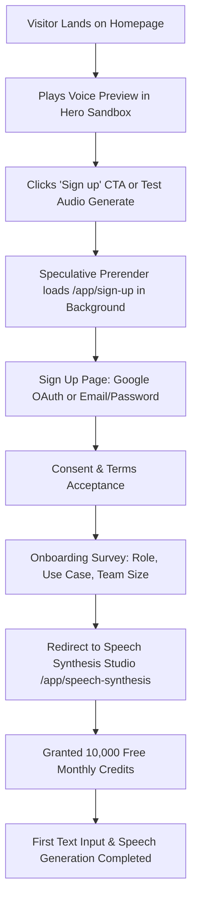
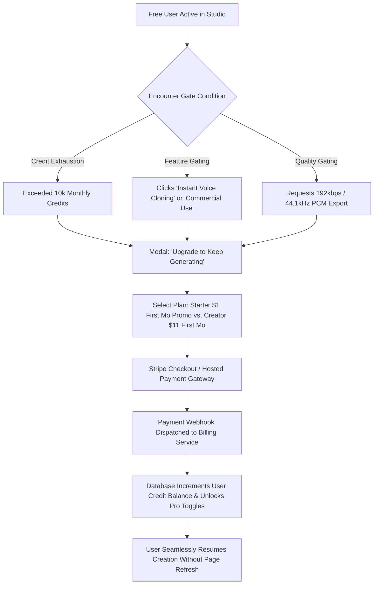
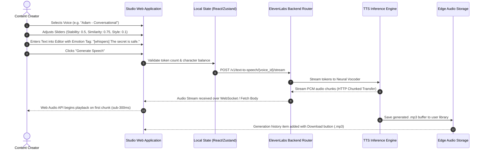
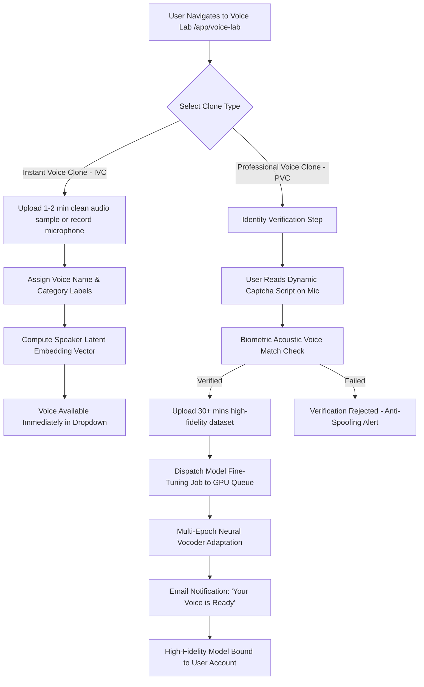
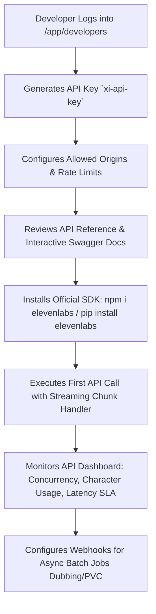

# End-to-End User Experience & Funnel Flows: ElevenLabs

**Subject:** Architectural mapping of customer acquisition, core application workflows, subscription conversion loops, and developer onboarding.  
**Source Evidence:** Public navigation paths, accessible controls, speculation rules, and authentication gateways observed on [https://elevenlabs.io](https://elevenlabs.io).

---

## 1. Flow 1: Visitor to Free Registered User (Acquisition & Activation)

The onboarding flow is optimized to minimize time-to-first-sound (TTFS) while capturing user intent and securing consent.

### Key Behavioral Design Observations:
1. **Interactive Sandbox Prior to Auth**: Visitors can listen to pre-rendered voice samples directly from the homepage without creating an account.
2. **Sub-second Transition**: The browser uses Chrome Speculation Rules to pre-render `/app/sign-up` upon page load, removing network latency when the user clicks the CTA.
3. **Frictionless Google OAuth**: Deep integration with Google Identity allows 1-click registration (`/app/external-auth/google`).

---

## 2. Flow 2: Free User to Paid Subscriber (Monetization & Conversion)

The conversion trigger occurs whenever a user encounters quota depletion, commercial usage needs, or advanced feature gates.

### Psychological Conversion Drivers:
- **Aggressive Introductory Pricing**: Offering 83% off Starter ($1) and 50% off Creator ($11) creates an impulsive conversion threshold.
- **Credit Visibility**: Persistent live counter in the sidebar showing remaining credits updates in real time as characters are typed.

---

## 3. Flow 3: Text-to-Speech Generation Pipeline

The central core creation loop used by hundreds of thousands of daily active users.

---

## 4. Flow 4: Voice Cloning Workflow (IVC vs. PVC)

Contrasting the instant zero-shot embedding flow with the asynchronous model training pipeline.

---

## 5. Flow 5: AI Video & Audio Dubbing Workflow

A multi-stage localization assembly line.

```mermaid
flowchart LR
    A[Upload Video MP4/URL] --> B[Audio Separation Demucs]
    B --> C[Speaker Diarization]
    C --> D[Whisper Transcription]
    D --> E[LLM Translation with Time Constraints]
    E --> F[Synthesize Translated Audio via Cloned Voices]
    F --> G[Audio Ducking & Resync]
    G --> H[Dubbing Studio NLE]
    H --> I[Export Rendered Video with Target Language Audio]
```

---

## 6. Flow 6: Developer API Integration Flow

The journey for developers building external SaaS products on top of ElevenLabs infrastructure.

